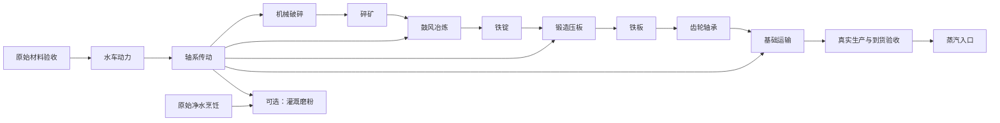
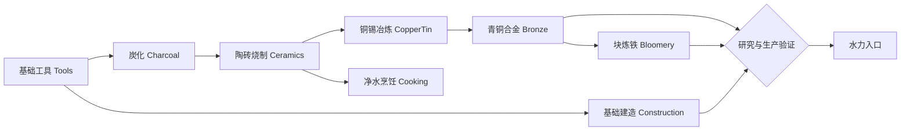

# 废土回路：项目开发大纲

日期：2026-11-20

## 项目方向与状态边界

Unity 俯视角 2D 生存、自动化与合作游戏。玩家从废土中的工具、燃料、食物和庇护起步，逐步恢复机械动力、电气工业、化工、精密制造与核能体系。全队共享世界工业科技与研究进度；角色的个人成长、技能和装备发展独立，不要求每名队员重复研究工业科技，也不以某人的个人等级锁住全队工厂。

本大纲描述开发方向、候选内容与已验证的实施范围。**原始、水力、蒸汽及LV电气化首批闭环已接入；LV包含8项研究、机械启动电气部件、供配电、电动加工、自动装配、过滤分流和同网断路保护。MV首批石化闭环也已接入：有限油藏、8项研究、LV启动分馏与反应、柴油、聚合与润滑、中压扩产和冷却回收；HV 精密材料与控制也已接入，包括石英、硅材、电子器件与高压装配；核时代设施扩展仍为规划。** 项目已有若干时代设备、动力或建造功能，不代表本大纲中的前置材料、独立工序、研究条件和完整生产链已实现。现有功能的具体边界以相关实现文档、源码及当次验证为准；核心检查、离线编译、Editor运行和联机证据分开记录，旧文档中的版本和检查结果保留其历史语境。2026-11-20 起按用户要求不考虑旧存档：新增阶段以新世界和当前格式保存恢复为验收范围，不新增迁移、历史研究旁路或旧世界补矿。

相关项目文档：

- [探索与生存扩展](DEMO_EXPANSION.md)：食物饮水、种植、天气、探索与表现的既有说明。
- [模块建筑与蒸汽厂房](MODULAR_BUILDINGS.md)：围合空间、门、锅炉模块、机械传动与既有兼容约定。
- [季节与区块世界](SEASONS_CHUNKS.md)：季节、区块生成与旧世界边界。
- [聚落分区](SETTLEMENTS.md)：聚落分布、用途与资源环境。
- [地标建筑](LANDMARK_BUILDINGS.md)、[楼层系统](FLOORS.md)：探索空间与建造环境。

## 2026-11-20 地貌与聚落补充

自然生成蓝图中，公寓、医院和超市限定于高、低密度市区；郊区和乡村的权重为零，不影响玩家建造。实现和公开接口检查见 `SETTLEMENTS.md`。

以提交 `6f1d4cb` 为基线的隔离源码快照中，聚落检查 12/12 通过，完整核心检查 617/618。唯一失败是“world generation 100 seeds deterministic varied complete and reachable”（spawn is confined to a pocket）；在相同快照恢复原版 `SettlementGeneration.cs` 并复跑该项，仍得到同一失败，因此不是本次建筑权重修改引起。

seed 73149 的既有游戏截图已作静态观感检查：可见道路/铺地局部压过水面，雪地水岸阶梯感明显，部分群系边界对比偏硬。配套 1024×1024 原始采样图中，river-only 水体按四邻域计 43 个组件、八邻域计 28 个组件；其中 (105,-314) 与 (104,-315) 是只对角相接的实例。该计数涵盖自然水面样本，不等同于 43 条互不相连的河，也未纳入道路、聚落及出生教学覆盖。静态截图和原始采样不能证明河流实际断路、通行失败或指定群系边界的最终游戏观感；本轮没有修改河网或过渡渲染。

实机近景尚缺沼泽—河谷、雪山—河谷、雪山—樱花林及河谷—樱花林边界。当前 Unity CLI 未发现连接中的 Editor，本轮未补拍 Play 画面；这些边界与河流通行仍列为待验收。

## 2026-11-20 取消起始区固定资源

新世界不再在出生教学区固定投放树木、铁铜锡铀矿、石材、黏土、煤、石灰石、耐火黏土、废料及两处补给箱，起始箱内的12木材也已取消。工作台、石炉、空箱子、出生点及地表道路保留；资源按既有自然群系与世界种子生成，需向外勘探，不再保证起始区具备全部推进材料。开局公告及资源详情已移除出生矿点保障提示。本次只调整新世界生成，不改写已生成世界。

通过用户确认的公开 `WorldGeneration.Generate` 入口，覆盖3个种子、3种预设、2种城市密度及普通/区块两种世界模式，检查固定投放为空、设施保留、自然资源存在且重复生成一致。以提交 `8f96765` 为基线、仅叠加本次代码的隔离源码检查中，定向22/22、完整617/617通过，历史迁移20项跳过；移除了不再适用的固定蒸汽矿床保障检查，采集和耗尽存档检查改为显式预置节点。此前出生区可达性失败在此次移除固定障碍后也通过。本轮未启动Unity或进行Play/人工试玩。

## 科技与生产设计原则

采用七时代、每时代八个候选研究节点，当前目录共 56 个，整体规模约 56 节点，可在实施审查中调整。时代组织认知和生产能力，不把每时代压成八步串行清单；阶段内允许能源、材料、加工、运输和生存支线并行，并在关键设备处交叉汇合。

参考现实工艺的因果关系，以及 Factorio 的生产驱动研究、GregTech 的材料和部件递进；保持逐步、适度复杂。先让每种新材料解决明确问题，再考虑拆分配方；不照搬外部作品的全部材料种类、配比、速度或研究费用。原始首批配置见下表；后续阶段的样品数量、产量门槛、持续时间、能耗和产率待设计与实测确定。

研究条件由“已完成的前置研究 + 少量可获得样品 + 累计产量或有效运行验证”组成。样品必须能由当前已解锁工艺取得；本节点新设备的产物只能用于后续研究或阶段验收，不能反过来成为解锁自身的必需品。研究页面应分别显示前置、样品、累计生产和运行状态，解释缺少什么及如何取得。

禁止循环解锁：研究依赖图与首批材料、工具、设备的制作依赖都必须能从起点走通。累计产量按权威模拟中的真实加工记录计算，不能通过搬运、拆装、多人重复提交或读档刷取。有效运行须有合法输入、供能与实际输出，空转不计；停机保留合法累计进度。

禁止随机硬锁：必要的石、黏土、铜、锡、铁及后续关键资源，应有可解释的勘探路径、可达的生成保障或明确替代来源，不以碰运气开箱取得唯一关键件。可回收物用于加速或提供替代路线，不能成为必出与否决定能否推进的唯一条件。有限资源可通过继续勘探拓展供给，不在同一资源点无限领取。

旧设备持续有用：手工工具用于外出维修，炭窑和陶窑持续供给材料，水车与轴系服务偏远工坊，蒸汽系统提供热与机械动力，低压设备承担独立小型产线。升级主要改善处理能力、效率、控制和适用工艺，不让时代切换自动报废已有设施。

## 七时代候选科技目录

以下表格列出研究意图与汇合方向，不宣称已接入代码。除下一节明确固定的原始依赖外，其余依赖为后续设计约束，落地前还须审查首批制造和无环性；“时代入口”不要求先清空上一时代的所有可选支线。

### 原始时代：材料与生存起点（首批已接入）

| 候选节点 | 研究标识 | 直接前置研究 | 目标能力 |
| --- | --- | --- | --- |
| 基础工具 | Tools | 起点，无前置研究 | 基础采集、手工加工与首批设施制作 |
| 炭化 | Charcoal | Tools | 木材炭化，炭窑与木炭供给 |
| 陶砖烧制 | Ceramics | Charcoal | 黏土烧制，陶窑、陶器与普通砖 |
| 铜锡冶炼 | CopperTin | Ceramics | 铜、锡的早期冶炼与样品生产 |
| 青铜合金 | Bronze | CopperTin | 青铜材料、工具与机械前期部件 |
| 块炼铁 | Bloomery | Bronze | 木炭块炼铁与后续铁材加工起点 |
| 基础建造 | Construction | Tools | 基础工坊、围护与设备布置 |
| 净水烹饪 | Cooking | Ceramics | 稳定净水、烹饪与容器使用 |

### 水力时代：连续机械动力（首批已接入）

| 候选节点 | 前置与汇合方向 | 目标能力 |
| --- | --- | --- |
| 水车动力 | 原始阶段水力入口验证 | 水域驱动的连续机械动力 |
| 轴系传动 | 水车动力 | 轴、连接与机械动力分配 |
| 机械破碎 | 轴系传动、原始铁材能力 | 矿石机械破碎 |
| 鼓风冶炼 | 轴系传动、铜锡冶炼与块炼铁 | 动力鼓风辅助冶炼 |
| 锻造压板 | 轴系传动、原始铁材能力 | 锻造、板材与轴坯 |
| 齿轮轴承 | 锻造压板、青铜合金 | 传动部件与基础轴承 |
| 基础运输 | 轴系传动、齿轮轴承 | 连续物料运输与装卸起点 |
| 灌溉磨粉 | 水车动力、轴系传动、净水烹饪 | 提水灌溉、谷物加工 |

2026-11-20 落地：水力时代入口仍由原始材料生产验收开启；进入时代后，在近距可见工作台逐项研究以上8项工艺。样品从研究者随身库存扣除，知识与生产验收全队共享，角色经验、属性点和技能点独立。前7项构成工业主线，灌溉磨粉为可选生存支线。

研究样品依次为：水车动力木材4＋青铜2；轴系木材4＋铁2；破碎铁3＋石4；鼓风陶砖4＋青铜2；锻压铁4＋青铜2；齿轮轴承铁板2＋青铜2；运输齿轮1＋轴承1＋木材4；农业青铜2＋陶砖2。齿轮轴承还需累计实际水力锻压2铁板；运输需实际制造齿轮2、轴承2，持有回收样品不能替代生产。

| 已接入设备 / 工艺 | 输入 → 输出 | 动力 / 时间 |
| --- | --- | --- |
| 机械粉碎机 | 铁矿1 → 碎铁矿1 | 20机械功率 / 2秒 |
| 鼓风炉 | 碎铁矿1＋木炭1 → 铁3 | 25机械功率 / 3秒 |
| 鼓风炉铜 / 锡配方 | 铜矿2或锡矿2＋木炭1 → 对应锭3 | 25机械功率 / 3秒 |
| 机械压机 | 铁1 → 铁板1 | 20机械功率 / 2秒 |
| 机械工坊齿轮 | 铁板1＋青铜1 → 齿轮2 | 15机械功率 / 3秒 |
| 机械工坊轴承 | 青铜2＋铁1 → 轴承2 | 15机械功率 / 3秒 |
| 机械装卸器 | 全工业物品缓冲 → 箭头方向相邻设备 | 5机械功率；基础速度为普通物流2倍，再乘实际供能比例 |
| 水力磨坊 | 生存库存小麦2 → 面粉3 | 10机械功率；近距定点操作，交互冷却2秒 |
| 灌溉泵 | 邻近水源 → 周围4格可见农田湿度 | 10机械功率；每泵每秒总补水8×供能比例，目标湿度最多65 |

加工时间为满功率、无工程加成的基准。水车40机械功率由沿边接触的轴系分配，供能不足按比例减速；机器与机器相邻不会自动变成传动轴。首批鼓风炉、压机、磨坊和泵用木材、石材、陶砖、铁、青铜建造；工坊增加铁板，装卸器增加铁板、齿轮和轴承，后续部件不反向要求电力、钢材或蒸汽设备。

蒸汽入口要求前7项研究、存活机械粉碎机，以及同一有效机械网络内有真实水车和传动轴时完成的碎矿≥4、鼓风铁≥6、铁板≥4、齿轮≥2、轴承≥2、装卸到货≥4；晋级仍消耗铁8＋青铜6。摆放设备、在背包放入样品、物流发出尚未到货均不计验收。缺料、满仓和断轴停机不增加计数，恢复条件后继续运行；装卸货物停电暂停，读档保持在途进度。

磨粉按钮位于科技页的水力工艺下方，按T后选择水力页，靠近已供能磨坊操作；手工磨粉小麦2→面粉1仍可使用。灌溉只补充实际可见且干燥的农田，按农田ID确定顺序分配，不穿墙、不消耗玩家随身净水。后时代蒸汽机械网络也能驱动这些设备，但水力阶段验收只累计真实水车＋轴系网络的操作。

保存升级为v12，工业物品扩至32槽，保留所有旧枚举序号。v1–v11世界保持既有水力规则，不追加研究锁、不虚构历史加工计数；新世界开启水力研究。新设备暂复用现有图集素材，通过名称区分，专用外观后续补充。

2026-11-20 验证：仅包含本轮水力差异的独立源码快照580/580核心检查通过；与当前项目整合后582/582通过。覆盖原始材料启动完整水力产线并晋级蒸汽、研究扣料和全队共享、缺料／满仓／断轴停机恢复、实际到货、磨粉／灌溉及负坐标跨区块保存恢复。水力改动的源码快照使用Unity工程引用完成离线C#编译，5份新增脚本元数据GUID检查通过；CLI未发现可连接Editor，因此本轮未取得Unity Editor编译、Play界面、从零人工采集或双进程联机的实测结论。

### 蒸汽时代：热工与钢铁（首批已接入）

| 候选节点 | 前置与汇合方向 | 目标能力 |
| --- | --- | --- |
| 焦化 | 炭化、水力材料生产验证 | 煤制焦炭及后续冶金燃料 |
| 耐火建材 | 陶砖烧制、水力加工能力 | 区别于普通砖的耐火炉衬 |
| 生铁冶炼 | 焦化、耐火建材、鼓风冶炼、机械破碎 | 矿石、焦炭与熔剂路线 |
| 钢铁精炼 | 生铁冶炼 | 生铁精炼为钢 |
| 模块锅炉 | 耐火建材、钢铁精炼、耐压管道 | 燃烧、给水、排烟和蒸汽集群 |
| 蒸汽驱动 | 模块锅炉、耐压管道、齿轮轴承 | 蒸汽转机械动力，衔接发电 |
| 机床加工 | 钢铁精炼、锻造压板、齿轮轴承 | 先用轴系驱动机床，后接蒸汽 |
| 耐压管道 | 钢铁精炼、机床加工 | 管道、接头、阀件与密封 |

首批机床可由水力轴系驱动，首批锅炉和管件可由既有锻造及机床制作，不要求先有蒸汽机才能制造蒸汽机；现有模块锅炉功能不能替代新增钢铁及管件工序的验收。

2026-11-20 落地：进入蒸汽时代后，在近距可见工作台独立研究8项工艺；研究者支付随身样品，全队共享知识，不消耗角色技能点。焦化与耐火建材可并行，再汇合为生铁、精炼钢、机床加工、耐压管道、模块锅炉与蒸汽驱动。首批高炉、精炼炉、压机和机床接水车＋轴系；研究完成后可换用蒸汽机械动力。

| 已接入研究 | 研究样品 | 实际生产前置 |
| --- | --- | --- |
| 焦化 | 煤4＋陶砖2 | 原始炭化、水力阶段验收 |
| 耐火建材 | 耐火黏土3＋陶砖2 | 原始陶砖、水力阶段验收 |
| 生铁冶炼 | 焦炭2＋耐火砖2＋石灰石1 | 焦化、耐火、鼓风、破碎；实际焦炭≥3、耐火砖≥4 |
| 钢铁精炼 | 生铁2＋石灰石1 | 生铁研究；实际生铁≥3 |
| 机床加工 | 钢2＋齿轮1＋轴承1 | 钢铁、压板、部件研究；实际钢≥2 |
| 耐压管道 | 钢板2＋青铜2 | 机床研究；实际钢板≥2 |
| 模块锅炉 | 钢板2＋耐火砖2 | 耐火、精炼、管道研究；实际钢板≥2、管件≥2 |
| 蒸汽驱动 | 管件2＋齿轮1＋轴承1 | 锅炉、管道研究；随后真实运转验收 |

| 设备 / 工艺 | 输入 → 输出 | 基准动力 / 时间 |
| --- | --- | --- |
| 焦炉 | 煤4＋木炭1 → 焦炭3 | 无外部动力 / 4秒 |
| 耐火窑 | 耐火黏土3＋石1＋木炭1 → 耐火砖4 | 无外部动力 / 4秒 |
| 炼铁高炉 | 碎铁矿2＋焦炭2＋石灰石1 → 生铁3 | 30机械功率 / 4秒 |
| 精炼炉 | 生铁3＋石灰石1＋木炭1 → 钢2 | 25机械功率 / 4秒 |
| 既有机械压机的钢板配方 | 钢1 → 钢板1 | 20机械功率 / 3秒 |
| 机床 | 钢板1＋青铜1 → 耐压管件2 | 25机械功率 / 3秒 |
| 蒸汽高炉的钢材配方 | 生铁3＋石灰石1 → 钢3 | 50蒸汽功率 / 4秒 |

煤、石灰石、耐火黏土是有限矿床，空手可采，现有石镐／钢镐提高采集效率。煤偏针叶林与冻原，石灰石偏河谷、沙漠与雪山，耐火黏土偏湿地、沼泽与河谷；所有自然群系都有少量背景供给。新世界不再提供出生区固定露头，初始区域及后续区块按既有自然资源规则生成，耗尽后不原地补充；不保证任一出生区域包含全部材料。群系分布为玩法抽象，并非现实地质勘探模型。蒸汽矿机可采集上述原料及既有矿物，产物可取出或通过物流输出；LV采矿机目前仍只采铁、铜、锡、铀。

普通陶砖用于首批焦炉／耐火窑，耐火砖用于高炉、精炼炉和锅炉炉衬；首批高炉与精炼炉用铁板、齿轮建造。机床只需铁板、首批钢、齿轮轴承。锅炉用钢板、耐火砖、管件，给水泵用钢、管件、青铜，蒸汽引擎用钢板、管件、齿轮轴承。耐压管件抽象包含管段、接头、阀件及密封结构，不额外引入橡胶或电力前置。新设备暂复用现有图集；煤、石灰石、耐火黏土用不同色调区分。

燃烧室接受煤、焦炭或既有燃料，每份20秒、最高120热功率；手动补料和物流都接受三者。锅炉、燃烧室、岸边给水泵、烟囱须按占地边缘接触成组，输出由锅炉、热、给水、排烟容量的最小值约束。缺水、缺烟囱或断开集群即停止产汽；该阶段沿用容量模型，尚无温压、蓄热或水量库存模拟。引擎消耗60蒸汽功率，输出48机械功率，经接触轴系驱动消费者。

LV入口要求完成8项研究，实际焦炭≥6、耐火砖≥8、生铁≥6、钢≥4、钢板≥4、管件≥4，以及由有效模块锅炉供汽的蒸汽引擎经同网传动轴完成的机械加工产出≥4；还需存活蒸汽高炉，晋级扣钢6＋青铜4。库存、搬运、摆放和空转均不能替代实际生产。缺料、满仓、断轴或缺少锅炉模块时不累计；当前格式保存恢复保持合法进度，预览与恢复不扣燃料。

科技入口：按T切换蒸汽页，查看8项研究、材料、前置、实际产量缺口、配方速查与群系采集方向；新设备可从页面下方设备列表选取建造。蒸汽交付时工业物品扩为40槽、建筑目录49项、保存格式v13；当前格式以HV章节为准，不开发旧存档兼容。默认核心检查排除20项历史存档迁移检查，保留代码，可显式传入 --historical 查看，结果不计入本轮验收。

2026-11-20 验证：582/582当前核心检查通过；包含原始到水力既有回归、从水力材料启动焦化／耐火／钢铁／管件／模块锅炉／蒸汽引擎并晋级LV、研究扣料共享、停机恢复、燃料物流、有限资源与群系分布、当前格式保存校验。72个游戏脚本使用Unity工程引用离线C#编译通过。尚未取得本轮Unity Editor、Play、从零人工采集或双进程联机证据。

### LV 时代：电气化与基础自动化（首批已接入）

时代入口仍由蒸汽阶段验收，进入LV不自动获得电气设备。先用既有陶窑烧制陶瓷绝缘件，机床经水车或蒸汽引擎轴系拉制铜线，再分别研究发电配电与绝缘电缆。研究消耗随身样品，要求近距可见工作台，全队共享，不消耗角色技能点。

| 已实现节点 | 前置研究与实际生产要求 | 样品扣料 | 解锁能力 |
| --- | --- | --- | --- |
| 发电配电 | 蒸汽验收；铜线≥4、绝缘件≥2 | 铜线4＋绝缘件2＋钢2 | 机械绕线台、燃料发电机、蒸汽发电机、电线杆 |
| 绝缘电缆 | 蒸汽验收；铜线≥4、绝缘件≥2 | 铜线4＋绝缘件2 | 工作台制作早期电缆，无需聚合物 |
| 电动机 | 发电配电＋绝缘电缆；线圈≥2、电缆≥4 | 线圈1＋电缆2＋铁板2 | 工作台装配首批电机 |
| 电动加工 | 发电配电＋绝缘电缆＋电动机；电机≥2 | 电机1＋电缆2 | 电动破碎机、电采矿机、电炉及电炉铜线配方 |
| 继电电路 | 发电配电＋绝缘电缆；线圈≥1、电缆≥2 | 线圈1＋铜线2＋绝缘件1 | 工作台继电器、电路装配机及基础电路 |
| 自动装配 | 电动加工＋继电电路；LV电加工≥4、基础电路≥2 | 电路2＋电机1 | 装配机批量制造电缆／电机／继电器、炮塔供弹 |
| 分流过滤 | 继电电路；基础电路≥2 | 电路2＋电缆2 | 5 kW过滤分流器；选定物品送前方，其余送左侧 |
| 断路保护 | 发电配电＋绝缘电缆＋继电电路；基础电路≥2 | 继电器2＋电缆2 | 所在LV连通网过载跳闸，降载后人工复位 |

#### 首批电气生产链

| 工序 | 设备与动力 | 输入 → 产出 | 周期 |
| --- | --- | --- | --- |
| 陶瓷绝缘件 | 陶窑；无外部动力 | 黏土2＋陶砖1＋木炭1 → 绝缘件2 | 4秒 |
| 机械拉线 | 机床；25机械功率 | 铜锭1 → 铜线3 | 3秒 |
| 早期电缆 | 工作台；手工 | 铜线2＋绝缘件1 → 电缆2 | 交互冷却0.5秒 |
| 机械绕线 | 绕线台；25机械功率 | 铜线4＋绝缘件1＋铁锭1 → 线圈1 | 3秒 |
| 首批电机 | 工作台；手工 | 线圈1＋钢1＋齿轮1＋轴承1 → 电机1 | 交互冷却0.5秒 |
| 首批继电器 | 工作台；手工 | 线圈1＋铁板1＋绝缘件1 → 继电器1 | 交互冷却0.5秒 |
| 电动破碎 | 电动破碎机；LV 25 kW | 铁矿1 → 碎铁矿2 | 2秒 |
| 电炉铜线 | 电炉；LV 35 kW | 铜锭1 → 铜线4 | 2秒 |
| 基础电路 | 电路装配机；LV 45 kW | 继电器1＋电缆1＋铁板1 → 电路2 | 3秒 |
| 自动电缆 | 装配机；LV 45 kW | 铜线4＋绝缘件2 → 电缆4 | 3秒 |
| 自动电机／继电器 | 装配机；LV 45 kW | 与手工电机／继电器相同输入 → 对应部件1 | 3秒 |

发电机使用钢板、线圈、绝缘件、齿轮与轴承，不要求已有电机；绕线台使用既有机械件，不要求电气产线。新部件继续消耗既有群系资源链中的铜、黏土、铁和钢，未引入脱离群系采集的免费原料。首批绝缘采用陶瓷，MV聚合物与HV半导体都不是启动前置。四种新增设备为绕线台（2×2）、过滤分流器（1×1）、断路器（1×1）和电动破碎机（2×2）；既有电气设备成本同步加入真实部件。

过滤分流器只有带电且解锁时才发送和推进在途包；目标堵塞不借另一出口混线，容量、在途预留、孤包返还与拆除遵循现有守恒规则。存在进出在途包时禁止改过滤项；只有匹配物品真实到达目标才累计过滤验收，取放与拆除不计。

断路器保护其所在LV连通网：有有效发电且总需求超过供给时，在消耗tick的生产前跳闸，整网分配归零；其他独立网继续工作。保护保持到人工复位，持续过载拒绝复位；手动断开也停止同网供电。配置指令0断开、1复位接通；存储setting=0闭合、1断开，tripped另存跳闸锁存。保存恢复与无消耗预览不制造跳闸或生产记录。该规则为全网保护抽象，尚未实现电缆段拓扑、选择性支路保护或继电逻辑编程。

MV入口要求8项研究全部完成，实际铜线≥12、绝缘件≥8、电缆≥8、线圈≥4、电机≥2、继电器≥4、基础电路≥6、LV加工产出≥8、装配机产出≥4、过滤匹配到货≥4、闭合同网保护下加工产出≥4；还需存活电路装配机，晋级扣电路6＋钢8。库存、研究样品、搬运、空转和远处保护器均不能代替生产验收；不要求故意制造过载才能晋级。

界面：按T进入LV低压页，查看8项研究、真实产量缺口、启动路线和配方；工作台可制作电缆、电机、继电器，设备检查可配置过滤物品或断开／复位断路器。当前工业库存46槽、建筑目录53项、保存格式v15；仅验证当前格式，不开发旧存档兼容。

2026-11-20 验证：仅叠加本轮LV差异并整合至13db0f9的独立源码快照中，新增29/29项LV检查通过；完整核心检查617/618通过，排除20项历史存档检查。唯一失败为“world generation 100 seeds deterministic varied complete and reachable”（出生区域被困），在未包含LV改动的a4886bb基线亦复现，本轮未修改其世界生成逻辑。完整生产链检查从蒸汽材料与全零LV进度起步，经玩家指令实际制造配方140–150及电路60、完成8项共享研究、过滤到货与保护网加工后合法晋级MV；覆盖扣料、当前保存深拷贝、加工／在途包续跑和非法进度拒绝。82个游戏脚本使用Unity工程引用离线C#编译通过，4份新增脚本元数据GUID唯一。CLI未发现可连接Editor，尚无本轮Unity Editor编译、Play界面、从零人工采集或双进程联机实测；独立模拟中的双玩家检查不代表联机验证。

### MV 时代：石化与中压工业（首批闭环已接入）

| 研究节点 | 前置与真实验收 | 解锁能力 |
| --- | --- | --- |
| 石油勘探 | 完成LV验收并进入MV；电路2、电机1、管件2 | 搜索48格内已生成油藏，报告坐标、方位、距离、群系和库存 |
| 抽油输液 | 石油勘探、实际发现油源；电机1、管件2 | 抽油机、工艺取水泵、液管与储液罐 |
| 原油分馏 | 实际抽油4、管输到货2；原油4、耐火砖2 | LV分馏装置与基础化学反应器 |
| 燃料精制 | 实际分馏4原油；轻质馏分2 | 轻馏分精制柴油 |
| 聚合反应 | 实际分馏4原油；化工原料1、工艺水2 | 轻馏分转化、基础聚合与首批冷却液 |
| 工业润滑 | 分馏、精制研究，实际柴油2；重馏分1、柴油1 | 重馏分制润滑油，或配煤回供普通燃料 |
| 中压变电 | 聚合、润滑研究，实际聚合物2、润滑油2、柴油2；聚合物2、润滑油1、电缆2 | 柴油供能、中压配电、降压与化工厂扩产 |
| 化工冷却 | 抽油、聚合研究及实际聚合物2；电机1、冷却液2 | 使用冷却液的中压聚合及冷却塔热液回收 |

研究样品从研究者背包实际扣除，全队共享；需要近距可见工作台，不花人物技能点。只持有样品、搬运、空转或摆放机器不能代替实际生产。T页可查看前置、样品扣料、研究按钮与生产缺口，勘探按钮只查询已有油藏，不生成远处区块，也不发放原油。

首批抽油机20 kW、取水泵10 kW、分馏装置40 kW及基础反应器40 kW均接LV，建材只需既有钢板、耐火砖、管件、电机、电缆和基础电路。分馏和基础反应器在岸上以邻水被动冷却，分馏另消耗普通燃料供热；无需先造MV发电设备、聚合物或工业冷却液。中压变电和化工冷却用于后续扩产。

| 配方 | 实际输入 → 整批产出 | 设备与条件 |
| --- | --- | --- |
| 161 原油分馏 | 原油4＋普通燃料1 → 轻馏分2＋化工原料1＋重馏分1 | LV分馏、近水，4秒 |
| 165 柴油精制 | 轻馏分2 → 柴油2 | LV基础反应器、近水，4秒 |
| 160 轻馏分转化 | 轻馏分2＋工艺水1 → 化工原料2 | LV基础反应器、近水，4秒；独立于分馏与聚合的玩法转化工序 |
| 70 基础聚合 | 化工原料2 → 聚合物2 | LV基础反应器、近水，4秒；替代木材＋燃料的简化路线 |
| 162 润滑加工 | 重馏分2 → 润滑油2 | LV基础反应器、近水，4秒 |
| 163 重馏分燃料调制 | 重馏分1＋煤1 → 普通燃料2 | LV基础反应器、近水，3秒；重质副产另一去向 |
| 71 基础冷却液 | 工艺水2＋聚合物1 → 冷却液2 | LV基础反应器、近水，3秒 |
| 164 中压冷却聚合 | 化工原料4＋冷却液1 → 聚合物4＋热冷却液1 | MV化工厂80 kW，3秒 |
| 91 冷却液回收 | 热冷却液2＋工艺水1 → 冷却液2 | MV冷却塔60 kW、近水，3秒；替代免费产冷液 |

抽油机每2秒扣有限油藏1库存、产1原油，取水泵每2秒产2工艺水。柴油发电机只消耗精制柴油，每份运行20秒、输出240 kW；普通木制燃料不能启动。中压电杆和变压器建材含聚合物，柴油设备与变压器另需润滑油；变压器仍为MV→LV降压（完成高压电网研究后可设HV→MV），未新增无源升压。

液体使用与现有固定tick物流一致的离散单位和在途包，液管／储罐各自只收设定液种，箭头指向下游；9种液体为原油、轻馏分、化工原料、重馏分、柴油、润滑油、工艺水、热冷却液和冷却液。空存量且无进出在途包时可改液种；E有货先取、空时从背包罐装补入。液体不能进入普通箱、传送带、装卸器或分流器；固体不能进入液管和储罐。多产物配方整批检查空间，任一副产满仓则停机且不扣料；E可取出副产，或按对应液种输出储存。管输有到货和退回容量预留，不能靠保存恢复重复产出。本轮没有实现连续流量、压力、水头或多端口流体求解。

HV入口要求8项研究全部完成，实际勘探1、抽油12、液体管输到货8、分馏原油12、柴油4、聚合物4、润滑油2、冷却回收4、中压化工产出4；仍需存活化工厂，并扣聚合物8＋基础电路8。MV 交付时保存格式 v16、工业物品 54 槽、建筑目录 59 项；当前格式见 HV 章节。

2026-11-20 验证：本轮独立源码快照经 .NET SDK 8.0.318 从源码运行核心检查657/657通过，0失败，另20项历史兼容检查按既定入口跳过；其中40项新增MV检查覆盖研究扣料、真实生产与管输、副产堵塞、油源与泵位、当前保存及中途恢复到HV。60组种子／世界预设／密度／区块模式组合验证油源位于教学区外、可达且能通过真实建造指令放置2×2抽油机。玩家进阶夹具从已完成LV与零MV物料、研究和计数起步，经真实命令与生产完成8研究、中压加工、热液回收及HV晋级；岸线、油藏、既有LV供能和前阶段材料由夹具提供，未覆盖从零采集和战斗。相同快照87个游戏脚本使用Unity 6000.6.8f1程序集及DEADCIRCUIT_NETCODE定义离线编译通过。Unity CLI当时无可连接Editor；未做本轮Editor Play界面、从零人工采集或双进程联机实测，离线编译与纯模拟多人指令不替代这些证据。

### HV 时代：精密材料与控制（首批闭环已实现）

| 研究 | 前置与实产验收 | 解锁 |
| --- | --- | --- |
| 硅材制备 | 完成 MV 石化验收并进入 HV | 蒸汽高炉冶炼工业硅；中压硅材精炼机提纯 |
| 晶圆制造 | 硅材制备；工业硅 4、高纯硅 2 | 切制晶圆，消耗冷却液并排出热冷却液 |
| 半导体器件 | 晶圆制造；晶圆 4 | 中压电子工台封装器件、制造太阳能板 |
| 多层电路 | 半导体器件；半导体 4 | 用基础电路、聚合物、铜线与器件组装高级电路 |
| 精密装配 | 多层电路；高级电路 2 | 钢板、轴承和润滑油加工成精密部件 |
| 耐热合金 | 硅材制备；与电子链并行 | 蒸汽高炉生产游戏耐热合金 |
| 自动控制 | 精密装配；精密部件 4 | 中压电子工台制造首批控制模块，开放满仓自动暂停 |
| 高压电网 | 自动控制、耐热合金；控制模块 2、合金 4 | 高压发电机、电杆、精密装配机、HV→MV 变压器档 |

靠近可见工作台，按 T 进入高压页。每项研究消耗随身样品，全队共享；产量来自完成的加工批次，搬运同种物资不计。进入 HV 后，依次用蒸汽和 MV 电力建立石英 → 工业硅 → 高纯硅 → 晶圆 → 半导体 → 高级电路 → 控制模块产线。精密部件与耐热合金分支汇入装配及高压设备。硅材精炼机和电子工台分别使用 60 kW、70 kW 的 MV 电；太阳能板由半导体研究解锁，仍在白昼输出最高 40 kW 的 MV 电，不是主线前置。这里的材料与配方是游戏抽象。

高压精密装配机默认每批消耗高级电路 2、精密部件 2 和冷却液 1，产控制模块 2 与热冷却液 1。热液可通过现有液体物流送往冷却塔。联锁模式按每种配方产物分别预留整批空间，计入在途预留；任何产物将超过 8 份时暂停，腾出空间后继续，原料仍按常规库存上限管理。

核时代入口要求 8 项 HV 研究、实际高压装配产出控制模块至少 4、控制模块总产至少 4、耐热合金总产至少 6，以及一台存活的精密装配机；晋级扣控制模块 4、耐热合金 4、冷却液 8。当前保存格式 v17、工业物品 62 槽、建筑目录 61 项；不扩展旧存档兼容。核时代设施扩展见下节。

2026-11-20 验证：独立源码快照 670 项核心检查通过，另有 20 项历史检查跳过；90 个游戏脚本使用 Unity 6000.6.8f1 工程引用离线编译通过。实产用例从已验收的 MV 与零 HV 物料、研究起步，经真实指令采矿、建造、研究和加工，恢复处理中存档后完成两批高压模块并支付晋级材料。Unity Editor 编译通过，尚未实测 Play 界面和双进程联机。

并行的生成器 10 自然开局在工作树联合验证中通过 676 项核心检查。该开局从实际出生点验证石英可达，并单独识别最多一处开局保障点，以保留对正常区块生成的其余断言。

### 核时代：受控热源与闭环设施（新增工艺规划）

| 候选节点 | 前置与汇合方向 | 目标能力 |
| --- | --- | --- |
| 铀矿选冶 | HV 材料与自动控制验证 | 铀矿分选、冶炼与受控物料管理 |
| 核燃料制备 | 铀矿选冶、辐射防护、精密装配 | 可用核燃料组件 |
| 辐射防护 | HV 材料与仪表能力 | 屏蔽、监测、隔离与人员防护 |
| 耐热结构 | 耐热合金、精密装配 | 反应堆和换热系统结构部件 |
| 反应堆控制 | 自动控制、辐射防护、耐热结构 | 调节、联锁、停堆与故障提示 |
| 换热发电 | 耐热结构、耐压管道、蒸汽发电能力 | 反应热传递、蒸汽与汽轮发电 |
| 循环冷却 | 化工冷却、耐热结构、自动控制 | 冷热液循环与余热排出 |
| 乏燃料储存 | 辐射防护、耐热结构 | 专用储存、转运和持续管理 |

核支线研究可并行；首次装料运行前必须完成燃料、防护、结构、控制、换热、循环冷却及乏燃料去向的综合验收。相关设施用前时代材料和未辐照样品验证，不能要求先产生乏燃料才能解锁其储存，也不能以反应堆已运行作为安全系统的解锁前提。

## 本轮原始扩展的固定依赖与范围

本轮只固定以下原始研究依赖；Tools 为研究起点，基础徒手采集和首批基础工具材料必须在起点可得。箭头表示研究前置，不表示所有物料加工都只能采用同一种设备。

首批实现新增有限、可耗尽的石材与黏土资源节点，以及木炭、陶砖、炭窑和陶窑。炭窑用木材4、石材6建造；陶窑用石材6、黏土4建造，均占2×2格，无需外部动力，不用自身产物反锁首台设备。首批只产陶砖，独立陶器物品及更多容器工艺仍属后续规划。

以下为本轮代码采用的初始配置，可随试玩调平衡；研究均需靠近可见工作台，扣除发起玩家持有的样品，全队共享结果，不花个人属性点或技能点。

| 研究 | 样品消耗 | 累计产量要求 | 当前解锁 |
| --- | --- | --- | --- |
| Tools 石制工具 | 木材2、石材2 | 无 | 石斧、石镐制作 |
| Charcoal 木炭烧制 | 木材4、石材2 | 无 | 炭窑：木材4 → 木炭2，基础周期4秒 |
| Ceramics 陶土烧结 | 黏土4、木炭1 | 无 | 陶窑：黏土4 + 木炭1 → 陶砖4，基础周期4秒 |
| CopperTin 铜锡冶炼 | 陶砖2、木炭1 | 陶砖≥4 | 石炉炼铜、炼锡：各1原矿 → 1锭，基础周期3秒 |
| Bronze 青铜合金 | 铜锭2、锡锭1 | 铜锭≥2、锡锭≥1 | 工作台：铜锭3 + 锡锭1 → 青铜4 |
| Bloomery 块炼铁 | 青铜2、陶砖4 | 青铜≥4 | 石炉：铁矿1 → 铁锭1，基础周期3秒；刀具制作 |
| Construction 基础建造 | 木材4、石材4 | 无 | 防护墙、门、储物箱、传送带 |
| Cooking 烹饪净水 | 陶砖2、黏土2 | 无 | 已有食物烹饪与原水煮沸操作 |

新世界石炉以木炭供热，每份支撑20秒有效加工；锁定配方或输出堵塞时不消耗燃料和原料。窑炉的热耗已包含在配方内，不再重复扣额外燃料。上述周期为无工程加成的基础值；研究产量按真实成品累计，采集和转移不算制造。

青铜在原始阶段由铜锡冶炼与合金工艺取得；块炼铁先提供铁材，水力再改进破碎、鼓风与锻压。基础建造不以尚未解锁的金属为强制起点材料，后续才开放砖和金属升级；净水烹饪的新增研究组织不等同于抹去既有生存功能。

本轮水力入口检查 Bronze、Bloomery、Construction 已完成，且累计制造青铜≥4、铁锭≥6、陶砖≥4、木炭≥2；保留存活工作台条件，晋级消耗木材12、铁锭6。Cooking 为可选生存支线。只有研究点亮、库存中捡到金属或摆下未运行设备均不能替代对应生产验证。基础建造的独立使用记录属于后续规划，本轮只验证该研究完成。

原始扩展的存档结构为v11，新增物品只追加到原编号后，物品数组为29槽；当时的新世界使用generator6生成石材/黏土。本次群系资源扩展将新世界切到generator7，仍沿用v11结构。v1–v10旧档保留原有科技玩法，新研究默认旁路，不追加材料、不重置产量或重新生成资源；原有generator3/4/5/6世界继续使用各自的后续区块分布。新世界不再直接赠送石斧、石镐和刀具，先徒手采集研究，再按解锁工艺制作。

2026-11-19 验证记录：全项目核心检查558/558通过，覆盖原始生产闭环、研究拒绝与扣料、队伍共享状态及v1–v11保存恢复；Unity 6000.6.8f1编译通过。Play模式下以独立内存世界验证8个研究按钮及状态刷新、29个材料格、研究行无重叠且内容可滚动，并通过Unity JSON的v11研究/物品往返检查；没有创建玩家世界存档。此范围不等同于双进程联机实测、人工界面操作或长期平衡验收。

## 群系、资源收集与生产衔接

### 本轮群系资源扩展

新世界的初始64×64区域与后续稀疏区块共用群系资源采样规则。资源分布同时考虑群系、世界坐标上的矿脉、岸线与聚落环境；资源检查面板展示实际节点所在群系、寻找方向和适用工具，户外位置提示展示当地资源方向。分布方向表示相对优势，不保证每个小区块都包含所有材料。

| 群系 | 自然资源方向 | 现有树木耗尽后的附带收获 | 主要生产用途 |
| --- | --- | --- | --- |
| 草甸 | 基础供给较均衡，可寻找石材与黏土；木材分布较疏 | 苹果、浆果，可能有种子 | 首批工具、工坊和种植起点 |
| 阔叶林 | 木材丰富，兼有黏土与铜矿供给 | 苹果、浆果，可能有种子 | 木炭、陶砖、铜材及远征补给 |
| 针叶林 | 木材丰富，石材、铁矿与锡矿较有优势 | 野蘑菇、浆果，可能有种子 | 燃料、块炼铁与青铜所需锡材 |
| 荒漠 | 石材、铜矿与铀矿较有优势；木材、黏土较少 | 少量浆果，可能有种子 | 石制设施、铜材与后期矿源勘探 |
| 湿地 | 黏土、锡矿与铜矿较有优势，适合寻找陶土原料 | 野蘑菇、浆果，可能有种子 | 陶砖、铜锡冶炼与青铜链 |
| 冻原 | 石材、铁矿与铀矿较有优势；树木较疏 | 野蘑菇、浆果，可能有种子 | 石材、铁材与后期矿源勘探 |

各群系均保留石、黏土、铁、铜、锡的非零候选机会；一格邻水的陆地提高黏土出现机会，使缺少黏土的地区也有明确寻找方向。木材继续受群系植被与世界预设影响；废料更受聚落开发程度影响，不作为某种自然群系的专属矿产。天然金属矿按矿脉聚集，仍须实地找到并运输，不能仅凭群系名领取材料。

当前基础候选概率（‰）如下，岸边额外增加160‰黏土候选；金属概率再乘以世界坐标矿脉系数。实际落点还受水域、道路、建筑占用、采集通路及区块实体预算约束，因此不等同于最终节点占比。

| 群系 | 石材 | 黏土 | 铁矿 | 铜矿 | 锡矿 | 铀矿 |
| --- | --- | --- | --- | --- | --- | --- |
| 草甸 | 25 | 30 | 22 | 18 | 14 | 3 |
| 阔叶林 | 18 | 18 | 14 | 14 | 12 | 2 |
| 针叶林 | 50 | 10 | 65 | 16 | 40 | 6 |
| 荒漠 | 100 | 3 | 24 | 65 | 12 | 16 |
| 湿地 | 12 | 95 | 12 | 45 | 60 | 3 |
| 冻原 | 90 | 6 | 70 | 18 | 14 | 20 |

出生教学区仅保留工作台、石炉和空箱子，取消固定树木、矿物、废料、补给箱及箱内木材。原始生产链所需材料依靠自然生成与勘探取得，群系差异用于推动勘探、运输与选址，不再提供固定开局材料保障。

2026-11-19 本轮验证：核心检查564/564通过，包含六群系抽样、按群系校正的岸边黏土优势、generator3–6输出基线、开局材料可达、资源耗尽与存档恢复。Unity 6000.6.8f1编译通过；编辑器内以独立内存世界验证六种资源提示、六类镐采集提示、v11/generator7的Unity JSON恢复，并在临时文本布局中检查三行区域无重叠或溢出。本轮未进行完整人工采集试玩或双进程联机测试。

### 采集与制造边界

石斧/钢斧提高伐木效率，石镐/钢镐提高石材、黏土和金属矿采集效率；未制作工具时仍能徒手取得起点材料。每次采集严格按节点余量和背包容量结算，耗尽后删除节点；离开区块、再次进入或读档不补满。工业科技产量仍只记录实际加工，采矿、伐木和搬运不增加制造里程碑。

树木附带收获沿用现有群系觅食规则，只在手动采尽时结算一次；部分采集、攻击摧毁和矿机作业不触发。提示报出实际入包的食物、种子或净水，满栈溢出不虚报为已获得。补给箱继续采用野外/建筑自身的物资规则，不被自然群系强行替换。

| 采集原料 | 已有加工衔接 | 扩展边界 |
| --- | --- | --- |
| 木材、石材 | 工具、首批设施；木材→木炭 | 后续木结构、维修与机械运输仍可使用 |
| 黏土 | 黏土+木炭→陶砖 | 独立陶器、容器与耐火材料仍属规划，不能把普通陶砖视为耐火炉衬 |
| 铜矿、锡矿 | 石炉→铜/锡锭→青铜 | 继续作为工具、轴系与电气材料起点 |
| 铁矿 | 原始块炼铁→铁锭 | 焦炭、生铁、钢与熔剂工序仍按后续时代计划扩展 |
| 铀矿 | 沿用现有后期矿物与配方入口 | 找到矿石不代替核燃料、防护、冷却和控制的科技验证 |
| 废料、建筑补给箱 | 既有回收与探索补给 | 用于加速或替代供给，不替代真实制造里程碑 |

### 后续资源规划

煤、石灰石、耐火黏土和有限原油已随蒸汽／MV阶段落地，并有采集或机器抽取路径；HV 已接入有限石英矿床和硅材加工。沙漠、雪山与河谷较多，其他群系有零星露头；支持徒手、镐具和蒸汽矿机采集。玻璃工艺仍待扩展。后续不只新增配方而遗漏原料来源。河谷沉积、岩层、地下矿带与油藏可作为比群系更细的分布层，具体材料、设备和分布须随相应时代另行验收。

## 主要生产链与首批制造路径

下列为目标工艺骨架，省略可在实施时合并的中间处理；箭头代表物料转换或用途，不代表已存在对应配方。催化剂、熔剂、工艺水、热量和副产物等接口应在实际配方设计时补齐，不能把本图当作现实完整配方。

| 生产线 | 目标链路 | 阶段与启动约束 |
| --- | --- | --- |
| 炭与陶砖 | 木材 → 炭化 → 木炭；黏土 + 燃料 → 烧制 → 砖/陶器 | 原始；不以成品反锁第一座窑 |
| 青铜 | 铜矿、锡矿 → 分别冶炼 → 铜、锡 → 青铜合金 | 原始；为工具及水力前期部件提供材料 |
| 铁与机械加工 | 铁矿 → 碎矿 → 铁 → 板、齿轮、轴 | 原始先允许手工处理及块炼铁，水力接入机械破碎和锻压 |
| 钢铁 | 煤 → 焦炭；铁矿 + 焦炭 + 石灰石 → 生铁 → 钢铁精炼 → 钢 → 机加工 | 蒸汽；区分块炼铁与生铁路线，普通砖不直接等同耐火炉衬 |
| 机械组件 | 板 + 齿轮 + 轴 + 轴承 → 机械组件、机架 | 水力起步，蒸汽精加工；各组件按用途组合，不强迫每台设备全部使用 |
| 电机 | 铜材 → 铜线；铁材 → 铁芯；铜线 + 铁芯 + 绝缘 + 机械组件 → 电动机 | LV；首批允许既有机械加工和手工装配 |
| 基础电路 | 铜线 + 绝缘板 + 基础元件 → 基础电路/继电电路 | LV；不要求硅晶圆或 MV 聚合物才能制作首批基础电路 |
| 石油化工 | 原油 → 分馏 → 柴油馏分、化工原料、重质馏分 → 燃料精制、聚合物、润滑材料等 | MV；柴油需相应精制，聚合前可补原料转化，不能将分馏直接视为聚合 |
| 精密电子 | 石英 → 工业硅 → 高纯硅 → 晶圆 → 半导体器件 → 高级电路 → 控制模块 | HV；与铜线、绝缘、化工和精密装配交叉 |
| 核能 | 铀矿选冶 → 核燃料 → 反应热 → 换热蒸汽 → 汽轮发电 | 核；同步接入控制、防护、冷热液循环与乏燃料专储 |

石油各馏分分别设置明确用途和储存去向，优先用可管理的少数类别表达，不为复杂而堆积相近物料。生物燃料是可选补充路线，可服务早期动力、应急或偏远据点，不强制所有玩家先走生物燃料才能进入石油工业；其输入、土地和加工成本须真实存在。

核能将热产生、换热、蒸汽驱动和电力输出分开；冷热液按回路流转并向外排热，不因写成循环而自动产生额外流体或能量。燃料消耗与乏燃料生成对应，乏燃料进入专用存储和转运流程，不用普通物品堆放代替。具体反应堆型、冷却介质和燃料细节留待专项设计。

## 能源等级与科技先进程度

LV、MV、HV 是游戏中的电压与供能分级，用于设备兼容、输配、变电和保护，不直接等同技术先进程度或现实电压标准，也不在此套用其他作品的数值。先进控制装置可以只需低压供电；高压线路本身不会自动解锁半导体制造。

科技决定能否制造、维护和控制某种设备；电源、线路、变电和保护决定设备能否在当前网络安全、有效地工作。机械、热、蒸汽与电力保持明确转换关系。太阳能回收整板的早期使用与 HV 自主制造分别登记，不能因找到一块太阳能板就跳过硅材生产线。

## 跨时代验证与合作规则

| 跨越 | 目标验收证据 | 必须避免的问题 |
| --- | --- | --- |
| 原始 → 水力 | 本轮验证青铜、块炼铁、建造研究和青铜/铁/陶砖/木炭产量；建造使用记录后续补充 | 只有研究或回收品即跳过材料链 |
| 水力 → 蒸汽 | 已接入前7项水力研究及真实水车＋轴系的破碎、鼓风、压板、部件和装卸到货；首批钢铁与耐火工艺留待蒸汽扩展 | 第一台机床反向要求蒸汽驱动 |
| 蒸汽 → LV | 钢材、机加工、蒸汽动力链验证，首批线圈与初级绝缘可制造 | 第一台发电机或电机需要电动产线 |
| LV → MV | 发电、供电、电动加工及基础电路有效工作，石油来源可勘探 | 聚合物与中压设备相互锁死 |
| MV → HV | 分馏、化工、冷却与中压配套验证，硅材和首批晶圆路径可启动 | 首批半导体反向要求高级控制模块 |
| HV → 核 | 完成八项研究、实际高压装配、合金与样品验收后进入核时代；燃料与安全配套属于后续核设施研究 | 仅凭库存跳过高压装配，或运行后才解锁核设施的安全配套 |

上述为规划验收口径，实际通过范围以各阶段验证记录为准。每次落地均核对研究无环、首批资源可得、材料/流体/能量守恒、输出堵塞与停机恢复。新世界验证阶段起点和资源来源，当前格式验证合法进度、库存深拷贝及中途恢复；按2026-11-20用户要求，不新增旧存档迁移、历史研究旁路或补矿，也不虚构历史产量。

研究与里程碑由房主权威模拟记录并同步。队员分工采集、加工、运输和防守共同贡献；重复提交、断线重连、死亡与读取存档不得复制样品或进度。验证共享研究与个人成长互不冒名覆盖，并核对联机显示与保存恢复一致。界面明确区分“研究可选”“研究完成”“设备可造”“产线验收”，不能只凭时代标签判定所有能力齐备。

## 持续发展的生存与防御辅助线

辅助线随工业并行演进，尽量复用现有探索、生存、建造和装备系统，不另堆一条必须逐项清空的同规模科技树。

| 辅助线 | 早期重点 | 工业化方向 |
| --- | --- | --- |
| 食物 | 采集、狩猎、烹饪和种植 | 磨粉、稳定加工、储存和物流 |
| 供水 | 原水采集、净水和容器 | 提水、管路、生产用水与冷却配套；生活净水与工艺回水分开 |
| 居住 | 围护、门、遮蔽和工坊 | 厂房分区、仓储、维护通路与危险设施隔离 |
| 装备 | 工具、近战和基础防护 | 机加工装备、配件、维修及职业分工；不吞并个人成长 |
| 防线 | 简单障碍、观察和合作守卫 | 供弹、供电、运输和控制联动的持续防御 |

生产停机、资源争夺和基地防守应形成可理解的压力，不能让随机灾害摧毁唯一解锁材料后永久卡死。旧工具、食物与基础防线在远征、补给和应急中持续发挥作用。

## 实施顺序与完成判据

1. **原始扩展（首批已接入）**：有限石/黏土、木炭/陶砖、炭窑/陶窑、8项研究、起点制作、水力入口及界面已接通，核心和Unity验证通过。下一步进行双进程联机实测、从零人工试玩与平衡调整，再扩展陶器等可选工艺。
2. **水力材料与机械闭环（首批已接入）**：8项工艺、鼓风／压板／部件、装卸运输、灌溉与磨粉已接入；首批机械件用原始材料及水车轴系启动。下一步人工从零试玩、联机与平衡验收，再扩展轴坯、机械组件等可选零件。
3. **蒸汽与钢铁闭环（首批已接入）**：焦化、耐火、生铁、钢板与机床先行，再接模块锅炉、管道和蒸汽引擎；实际经轴加工后开放LV入口。仍需Editor／人工试玩、联机与平衡验收。
4. **LV 自动化（首批已接入）**：陶窑与机械机床启动绝缘件和铜线，绕线后发展发电、电缆、电机、继电电路、电动加工与自动装配；过滤与保护由真实到货、同网运行验收。后续再扩展条件控制和选择性支路保护。
5. **MV 化工（首批闭环已接入）**：有限油源、勘探、抽油、分种液管、分馏、精制、转化、聚合、润滑、中压扩产及热液回收；后续再扩多端口和连续流体等规模化系统。
6. **HV 精密工业（首批已实现）**：完成硅材到控制模块产线，并行制造耐热合金；解锁满仓联锁、高压供配电和光伏制造，达标后开启核时代。
7. **核能综合设施（规划）**：先完成防护、结构、控制、冷却和专储设计与非装料验证，再进行首套核燃料—热—蒸汽—发电闭环验收。

每批以最小可玩的材料—设备—产出闭环交付，检查通过后再扩展细节。纯模拟检查、Editor 编译、实际运行、界面操作与多人联调分别记录覆盖范围；文档或某一种检查通过不替代完整运行验证。本文件记录规划与实际实施边界，后续配方、设备和平衡改动需与源码及验证记录同步。

## 主角外观与装备展示

“主角外观”入口仅在开始菜单首页显示。玩家在进入世界前调整并保存本机预设；新建、读取世界和加入联机世界时使用该预设。进入游戏后外观面板不会打开，桥接和模拟器也会忽略外观修改指令。角色预览可切换朝向、行走和装备显示，已穿戴护甲覆盖相应身体部位。

外观核心检查覆盖预设保存与载入、联机加入、存档快照及游戏内修改指令，现有 Release 检查产物返回 7/7 通过。当前源码重建在 `TechCatalog.cs:31` 遇到重复 switch case 值 49，Unity 菜单运行时复测仍待完成。

背包界面已调整为 PUBG 风格三栏布局：左栏浏览材料、装备、配件和制作，中栏只读显示当前幸存者外观与实时穿戴，右栏显示武器、工具、防具槽和选中详情。中栏沿用游戏内 `SurvivorVisuals.Sample` 的分层图像，装备变化会同步到纸娃娃；外观编辑仍只存在于开始菜单，背包不提供修改入口。运行时 QA 检查三栏顺序、预览舞台、40 个图层容器、装备槽、开始菜单外观入口的点击射线，以及游戏中禁止编辑外观。QA 科技种子使用完整的原始研究前置闭包（`primitiveResearch=127`），不会再生成无法读取的孤立研究位。

## 本地存档管理

「读取世界」可选中单个存档并删除。确认框显示世界名、种子和修改时间，默认焦点位于取消；确认后移除选中世界的主档及其临时文件和备份，再刷新列表。不改动存档格式。

2026-11-20 验证：Unity Windows Demo 构建成功（`214241742` bytes）；隔离 Backpack QA 通过，覆盖开始菜单外观、三栏背包、装备/配件/换弹、科技研究、建造、保存与读取，QA 存档原始研究位为 `127`。当前核心检查 `680/680` 通过，20 项历史检查跳过。隔离的 Unity Play 检查通过，覆盖无选择时禁用、取消、确认时屏蔽背景操作、同名存档独立删除以及删除最后一档后的空列表。键盘 Esc 未实测。

## 游戏文案整理（已实现）

统一物品与设备说明、时代研究、菜单、背包、生存指南和操作反馈的玩家用语。按钮优先说明动作；设备词条按用途、动力、运行条件和产出组织；研究提示区分所需材料与全队累计生产进度，保留同网运行、运输送达等条件。清除玩家界面中的“验收”“首批闭环”、内部配方编号及配置变量，统一“设备详情”“角色外观”“电路”“冷却液”等名称。同步修正蒸汽炼钢材料说明，保留现有开局、背包布局、配方数值、研究条件和存档结构。

本轮基于 `fba429a` 集成后验证：当前核心检查680/680通过，20项历史检查按既有规则跳过；使用项目Unity编译响应文件及实际引用进行离线C#编译，0错误，28条既有API弃用警告。代码差异核对仅涉及显示文本、文本拼接与一项群系名称断言；未执行Unity Play、界面溢出检查、设备实测或多人联机。菜单离开流程对保存失败状态的覆盖属于既有行为，本轮仅补充离开前确认存档成功的文字提醒，未更改保存流程。

文案参考：《Minecraft》[官方中文合成指南](https://www.minecraft.net/zh-hans/article/how-craft)的统一术语和操作顺序、《缺氧》[官方更新295825](https://kleiforums.com/game-updates/oni-alpha/295825-r624/)对氧气来源缺失与产量不足的分开提示，并参考《环世界》按问题、原因和操作组织提醒的方向。参考用于信息表达，不复制原作台词或新增其玩法。

## 自然建筑外观

自然生成的低层与高层建筑按旋转后的蓝图遮住内部；屋顶、檐口和重复楼层立面组成室外轮廓。高度按地上楼层数决定，不把地下室计入楼高。进入房屋后收起外壳，恢复原有真实室内；入口、开放庭院和加油站露天泵位保留。遮挡跟随本地玩家所在位置，远程玩家、屋顶下的设备与活动效果不会穿透外墙显示。玩家自行建造的房间不改变。素材位于独立外观图集并可由 SVG 源重建。

2026-11-20 验证：新增自然建筑外观专项检查 5/5 通过，覆盖 32 类蓝图的四向旋转、入口和室外空间、楼层高度、地下层及负坐标跨区块；完整 CoreChecks 679/679 通过，20 项历史检查跳过。外观图集 10 帧重生成检查通过，像素哈希为 `47f0c9ce94bb05affd82a67ae1284063e560bb3dfc2ab9f776ff21dc1b059262`。Unity 构建与 Play 画面检查仍待本轮完成。

## 外部参考与使用边界

以下为设计来源，查阅日期为 2026-11-19。引用用于工艺方向和玩法组织，不是实现承诺；现实工艺需按游戏尺度简化，外部作品的配方、研究费用及机器等级不直接成为本项目配置。

- [Factorio Wiki：Science pack](https://wiki.factorio.com/Science_pack)：参考通过生产物资推进研究的组织方式；本项目采用少量样品与真实生产/运行记录结合的方案。
- [GregTechCEu / GregTech Modern 官方文档：Bronze](https://gregtechceu.github.io/GregTech-Modern/1.21/Gameplay/Steam/Bronze/)：参考铜锡合金与材料递进、初级和机器加工路线的衔接，不照搬其阶段归属和配比。
- [EIA：Refining crude oil — the refining process](https://www.eia.gov/energyexplained/oil-and-petroleum-products/refining-crude-oil-the-refining-process.php)：参考炼油中的分离、转化与处理区分，支持分馏后继续精制和化工加工的规划。
- [EIA：Nuclear power plants](https://www.eia.gov/energyexplained/nuclear/nuclear-power-plants.php)：参考反应热、蒸汽、汽轮发电及冷却的能量转换关系；本项目的具体堆型和介质尚未定案。
- [worldsteel：Raw materials](https://worldsteel.org/about-steel/raw-materials/)、[What is steel?](https://worldsteel.org/about-steel/what-is-steel/)：参考铁矿、煤/焦炭、石灰石与高炉—炼钢工艺方向；本项目以生铁到钢的简化链表达，不据此声称已实现真实完整冶金流程。
