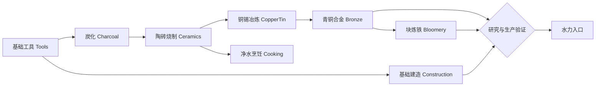

# 废土回路：项目开发大纲

日期：2026-11-19

## 项目方向与状态边界

Unity 俯视角 2D 生存、自动化与合作游戏。玩家从废土中的工具、燃料、食物和庇护起步，逐步恢复机械动力、电气工业、化工、精密制造与核能体系。全队共享世界工业科技与研究进度；角色的个人成长、技能和装备发展独立，不要求每名队员重复研究工业科技，也不以某人的个人等级锁住全队工厂。

本大纲描述开发方向、候选内容与已验证的实施范围。**原始时代首批闭环已接入，核心检查与 Unity 编译、运行时界面和 JSON 检查通过；多人联调及长期试玩待验证。其余新增工艺仅作规划。** 项目已有若干时代设备、动力或建造功能，不代表本大纲中的前置材料、独立工序、研究条件和完整生产链已实现。现有功能的具体边界以相关实现文档、源码及当次验证为准；旧文档中的版本和检查结果保留其历史语境。

相关项目文档：

- [探索与生存扩展](DEMO_EXPANSION.md)：食物饮水、种植、天气、探索与表现的既有说明。
- [模块建筑与蒸汽厂房](MODULAR_BUILDINGS.md)：围合空间、门、锅炉模块、机械传动与既有兼容约定。
- [季节与区块世界](SEASONS_CHUNKS.md)：季节、区块生成与旧世界边界。
- [聚落分区](SETTLEMENTS.md)：聚落分布、用途与资源环境。
- [地标建筑](LANDMARK_BUILDINGS.md)、[楼层系统](FLOORS.md)：探索空间与建造环境。

## 科技与生产设计原则

采用七时代、每时代八个候选研究节点，当前目录共 56 个，整体规模约 56 节点，可在实施审查中调整。时代组织认知和生产能力，不把每时代压成八步串行清单；阶段内允许能源、材料、加工、运输和生存支线并行，并在关键设备处交叉汇合。

参考现实工艺的因果关系，以及 Factorio 的生产驱动研究、GregTech 的材料和部件递进；保持逐步、适度复杂。先让每种新材料解决明确问题，再考虑拆分配方；不照搬外部作品的全部材料种类、配比、速度或研究费用。原始首批配置见下表；后续阶段的样品数量、产量门槛、持续时间、能耗和产率待设计与实测确定。

研究条件由“已完成的前置研究 + 少量可获得样品 + 累计产量或有效运行验证”组成。样品必须能由当前已解锁工艺取得；本节点新设备的产物只能用于后续研究或阶段验收，不能反过来成为解锁自身的必需品。研究页面应分别显示前置、样品、累计生产和运行状态，解释缺少什么及如何取得。

禁止循环解锁：研究依赖图与首批材料、工具、设备的制作依赖都必须能从起点走通。累计产量按权威模拟中的真实加工记录计算，不能通过搬运、拆装、多人重复提交或读档刷取。有效运行须有合法输入、供能与实际输出，空转不计；停机保留合法累计进度。

禁止随机硬锁：必要的石、黏土、铜、锡、铁及后续关键资源，应有可解释的勘探路径、可达的生成保障或明确替代来源，不以碰运气开箱取得唯一关键件。可回收物用于加速或提供替代路线，不能成为必出与否决定能否推进的唯一条件。有限资源可通过继续勘探拓展供给，不在同一资源点无限领取。

旧设备持续有用：手工工具用于外出维修，炭窑和陶窑持续供给材料，水车与轴系服务偏远工坊，蒸汽系统提供热与机械动力，低压设备承担独立小型产线。升级主要改善处理能力、效率、控制和适用工艺，不让时代切换自动报废已有设施。

## 七时代候选科技目录

以下表格列出研究意图与汇合方向，不宣称已接入代码。除下一节明确固定的原始依赖外，其余依赖为后续设计约束，落地前还须审查首批制造和无环性；“时代入口”不要求先清空上一时代的所有可选支线。

### 原始时代：材料与生存起点（首批已接入）

| 候选节点 | 研究标识 | 直接前置研究 | 目标能力 |
| --- | --- | --- | --- |
| 基础工具 | Tools | 起点，无前置研究 | 基础采集、手工加工与首批设施制作 |
| 炭化 | Charcoal | Tools | 木材炭化，炭窑与木炭供给 |
| 陶砖烧制 | Ceramics | Charcoal | 黏土烧制，陶窑、陶器与普通砖 |
| 铜锡冶炼 | CopperTin | Ceramics | 铜、锡的早期冶炼与样品生产 |
| 青铜合金 | Bronze | CopperTin | 青铜材料、工具与机械前期部件 |
| 块炼铁 | Bloomery | Bronze | 木炭块炼铁与后续铁材加工起点 |
| 基础建造 | Construction | Tools | 基础工坊、围护与设备布置 |
| 净水烹饪 | Cooking | Ceramics | 稳定净水、烹饪与容器使用 |

### 水力时代：连续机械动力（新增工艺规划）

| 候选节点 | 前置与汇合方向 | 目标能力 |
| --- | --- | --- |
| 水车动力 | 原始阶段水力入口验证 | 水域驱动的连续机械动力 |
| 轴系传动 | 水车动力 | 轴、连接与机械动力分配 |
| 机械破碎 | 轴系传动、原始铁材能力 | 矿石机械破碎 |
| 鼓风冶炼 | 轴系传动、铜锡冶炼与块炼铁 | 动力鼓风辅助冶炼 |
| 锻造压板 | 轴系传动、原始铁材能力 | 锻造、板材与轴坯 |
| 齿轮轴承 | 锻造压板、青铜合金 | 传动部件与基础轴承 |
| 基础运输 | 轴系传动、齿轮轴承 | 连续物料运输与装卸起点 |
| 灌溉磨粉 | 水车动力、轴系传动、净水烹饪 | 提水灌溉、谷物加工 |

### 蒸汽时代：热工与钢铁（新增工艺规划）

| 候选节点 | 前置与汇合方向 | 目标能力 |
| --- | --- | --- |
| 焦化 | 炭化、水力材料生产验证 | 煤制焦炭及后续冶金燃料 |
| 耐火建材 | 陶砖烧制、水力加工能力 | 区别于普通砖的耐火炉衬 |
| 生铁冶炼 | 焦化、耐火建材、鼓风冶炼、机械破碎 | 矿石、焦炭与熔剂路线 |
| 钢铁精炼 | 生铁冶炼 | 生铁精炼为钢 |
| 模块锅炉 | 耐火建材、钢铁精炼、锻造压板 | 燃烧、给水、排烟和蒸汽集群 |
| 蒸汽驱动 | 模块锅炉、耐压管道、齿轮轴承 | 蒸汽转机械动力，衔接发电 |
| 机床加工 | 钢铁精炼、锻造压板、齿轮轴承 | 先用轴系驱动机床，后接蒸汽 |
| 耐压管道 | 钢铁精炼、机床加工 | 管道、接头、阀件与密封 |

首批机床可由水力轴系驱动，首批锅炉和管件可由既有锻造及机床制作，不要求先有蒸汽机才能制造蒸汽机；现有模块锅炉功能不能替代新增钢铁及管件工序的验收。

### LV 时代：电气化与基础自动化（新增工艺规划）

| 候选节点 | 前置与汇合方向 | 目标能力 |
| --- | --- | --- |
| 发电配电 | 蒸汽驱动、机床加工、初级绝缘材料 | 机械发电与基础配电设施 |
| 绝缘电缆 | 铜材加工、初级绝缘材料、机床加工 | 铜线、电缆与安全布线 |
| 电动机 | 绝缘电缆、钢铁精炼、齿轮轴承 | 铜线、铁芯、绝缘及机械组件装配 |
| 电动加工 | 发电配电、绝缘电缆、电动机 | 电动破碎、加工与材料处理 |
| 继电电路 | 绝缘电缆、机床加工 | 基础电路、继电器与条件开关 |
| 自动装配 | 电动加工、继电电路 | 批量制造部件与设备 |
| 分流过滤 | 基础运输、继电电路 | 分类、分流与物料过滤 |
| 断路保护 | 发电配电、绝缘电缆、继电电路 | 过载隔离与故障反馈 |

LV 首批线圈、电机、发电机和基础电路允许用蒸汽/水力机床与手工工位制造；初级绝缘材料从陶瓷及可用的早期材料路线取得，不以 MV 聚合物或 HV 半导体作必需前置。

### MV 时代：石化与中压工业（新增工艺规划）

| 候选节点 | 前置与汇合方向 | 目标能力 |
| --- | --- | --- |
| 石油勘探 | LV 电气与加工验证 | 寻找油源和可解释的勘探反馈 |
| 抽油输液 | 石油勘探、电动机、耐压管道 | 原油采集、储存和输送 |
| 原油分馏 | 抽油输液、耐火建材、既有热源 | 按用途得到不同馏分 |
| 燃料精制 | 原油分馏 | 柴油等可用燃料及品质处理 |
| 聚合反应 | 原油分馏、基础温控与输液 | 化工原料转聚合物 |
| 工业润滑 | 原油分馏、燃料精制 | 重质馏分加工为润滑材料 |
| 中压变电 | LV 配电保护、聚合物、工业润滑 | 中压输配与设备供电 |
| 化工冷却 | 抽油输液、LV 条件控制与电动机 | 冷却回路与较大规模热管理 |

首批分馏、聚合和润滑生产采用 LV 供电与基础冷却；化工冷却和中压变电用于后续扩产，不作为首批化工材料的反向硬门槛。

### HV 时代：精密材料与控制（新增工艺规划）

| 候选节点 | 前置与汇合方向 | 目标能力 |
| --- | --- | --- |
| 硅材制备 | MV 化工、热工和中压供能验证 | 石英到工业硅及高纯硅 |
| 晶圆制造 | 硅材制备、化工冷却、既有机床 | 高纯硅成形、切片和晶圆处理 |
| 半导体器件 | 晶圆制造、聚合与化工基础 | 半导体器件生产 |
| 多层电路 | 半导体器件、继电电路、聚合物 | 高级电路与连接结构 |
| 精密装配 | 多层电路、自动装配、工业润滑 | 精密部件和控制模块制造 |
| 耐热合金 | 钢铁精炼、MV 材料加工与热工 | 高温设备的结构和换热材料 |
| 自动控制 | 多层电路、精密装配 | 传感、调节与联锁控制 |
| 高压电网 | 中压变电、耐热合金、自动控制 | 高压输配、变电与隔离 |

HV 表示本阶段重点能力；首批硅材、晶圆与器件须能由上一阶段的设备和基础控制启动，不能要求尚未制造出的高级控制模块或高压电网。太阳能板自主制造作为 HV 阶段关联规划，由硅材、器件、封装和电气配套支撑，不另计入上述八节点。早期可以回收整板并接入兼容供电系统，但回收不等于掌握光伏制造，也不是主线必需掉落。

### 核时代：受控热源与闭环设施（新增工艺规划）

| 候选节点 | 前置与汇合方向 | 目标能力 |
| --- | --- | --- |
| 铀矿选冶 | HV 材料与自动控制验证 | 铀矿分选、冶炼与受控物料管理 |
| 核燃料制备 | 铀矿选冶、辐射防护、精密装配 | 可用核燃料组件 |
| 辐射防护 | HV 材料与仪表能力 | 屏蔽、监测、隔离与人员防护 |
| 耐热结构 | 耐热合金、精密装配 | 反应堆和换热系统结构部件 |
| 反应堆控制 | 自动控制、辐射防护、耐热结构 | 调节、联锁、停堆与故障提示 |
| 换热发电 | 耐热结构、耐压管道、蒸汽发电能力 | 反应热传递、蒸汽与汽轮发电 |
| 循环冷却 | 化工冷却、耐热结构、自动控制 | 冷热液循环与余热排出 |
| 乏燃料储存 | 辐射防护、耐热结构 | 专用储存、转运和持续管理 |

核支线研究可并行；首次装料运行前必须完成燃料、防护、结构、控制、换热、循环冷却及乏燃料去向的综合验收。相关设施用前时代材料和未辐照样品验证，不能要求先产生乏燃料才能解锁其储存，也不能以反应堆已运行作为安全系统的解锁前提。

## 本轮原始扩展的固定依赖与范围

本轮只固定以下原始研究依赖；Tools 为研究起点，基础徒手采集和首批基础工具材料必须在起点可得。箭头表示研究前置，不表示所有物料加工都只能采用同一种设备。

首批实现新增有限、可耗尽的石材与黏土资源节点，以及木炭、陶砖、炭窑和陶窑。炭窑用木材4、石材6建造；陶窑用石材6、黏土4建造，均占2×2格，无需外部动力，不用自身产物反锁首台设备。首批只产陶砖，独立陶器物品及更多容器工艺仍属后续规划。

以下为本轮代码采用的初始配置，可随试玩调平衡；研究均需靠近可见工作台，扣除发起玩家持有的样品，全队共享结果，不花个人属性点或技能点。

| 研究 | 样品消耗 | 累计产量要求 | 当前解锁 |
| --- | --- | --- | --- |
| Tools 石制工具 | 木材2、石材2 | 无 | 石斧、石镐制作 |
| Charcoal 木炭烧制 | 木材4、石材2 | 无 | 炭窑：木材4 → 木炭2，基础周期4秒 |
| Ceramics 陶土烧结 | 黏土4、木炭1 | 无 | 陶窑：黏土4 + 木炭1 → 陶砖4，基础周期4秒 |
| CopperTin 铜锡冶炼 | 陶砖2、木炭1 | 陶砖≥4 | 石炉炼铜、炼锡：各1原矿 → 1锭，基础周期3秒 |
| Bronze 青铜合金 | 铜锭2、锡锭1 | 铜锭≥2、锡锭≥1 | 工作台：铜锭3 + 锡锭1 → 青铜4 |
| Bloomery 块炼铁 | 青铜2、陶砖4 | 青铜≥4 | 石炉：铁矿1 → 铁锭1，基础周期3秒；刀具制作 |
| Construction 基础建造 | 木材4、石材4 | 无 | 防护墙、门、储物箱、传送带 |
| Cooking 烹饪净水 | 陶砖2、黏土2 | 无 | 已有食物烹饪与原水煮沸操作 |

新世界石炉以木炭供热，每份支撑20秒有效加工；锁定配方或输出堵塞时不消耗燃料和原料。窑炉的热耗已包含在配方内，不再重复扣额外燃料。上述周期为无工程加成的基础值；研究产量按真实成品累计，采集和转移不算制造。

青铜在原始阶段由铜锡冶炼与合金工艺取得；块炼铁先提供铁材，水力再改进破碎、鼓风与锻压。基础建造不以尚未解锁的金属为强制起点材料，后续才开放砖和金属升级；净水烹饪的新增研究组织不等同于抹去既有生存功能。

本轮水力入口检查 Bronze、Bloomery、Construction 已完成，且累计制造青铜≥4、铁锭≥6、陶砖≥4、木炭≥2；保留存活工作台条件，晋级消耗木材12、铁锭6。Cooking 为可选生存支线。只有研究点亮、库存中捡到金属或摆下未运行设备均不能替代对应生产验证。基础建造的独立使用记录属于后续规划，本轮只验证该研究完成。

存档升至v11，新增物品只追加到原编号后，物品数组为29槽；新世界启用原始研究并用generator6生成石材/黏土。v1–v10旧档保留原有科技玩法，新研究默认旁路，不追加材料、不重置产量或重新生成资源；原有generator3/4/5分支继续沿用。新世界不再直接赠送石斧、石镐和刀具，先徒手采集研究，再按解锁工艺制作。

2026-11-19 验证记录：全项目核心检查558/558通过，覆盖原始生产闭环、研究拒绝与扣料、队伍共享状态及v1–v11保存恢复；Unity 6000.6.8f1编译通过。Play模式下以独立内存世界验证8个研究按钮及状态刷新、29个材料格、研究行无重叠且内容可滚动，并通过Unity JSON的v11研究/物品往返检查；没有创建玩家世界存档。此范围不等同于双进程联机实测、人工界面操作或长期平衡验收。

## 主要生产链与首批制造路径

下列为目标工艺骨架，省略可在实施时合并的中间处理；箭头代表物料转换或用途，不代表已存在对应配方。催化剂、熔剂、工艺水、热量和副产物等接口应在实际配方设计时补齐，不能把本图当作现实完整配方。

| 生产线 | 目标链路 | 阶段与启动约束 |
| --- | --- | --- |
| 炭与陶砖 | 木材 → 炭化 → 木炭；黏土 + 燃料 → 烧制 → 砖/陶器 | 原始；不以成品反锁第一座窑 |
| 青铜 | 铜矿、锡矿 → 分别冶炼 → 铜、锡 → 青铜合金 | 原始；为工具及水力前期部件提供材料 |
| 铁与机械加工 | 铁矿 → 碎矿 → 铁 → 板、齿轮、轴 | 原始先允许手工处理及块炼铁，水力接入机械破碎和锻压 |
| 钢铁 | 煤 → 焦炭；铁矿 + 焦炭 + 石灰石 → 生铁 → 钢铁精炼 → 钢 → 机加工 | 蒸汽；区分块炼铁与生铁路线，普通砖不直接等同耐火炉衬 |
| 机械组件 | 板 + 齿轮 + 轴 + 轴承 → 机械组件、机架 | 水力起步，蒸汽精加工；各组件按用途组合，不强迫每台设备全部使用 |
| 电机 | 铜材 → 铜线；铁材 → 铁芯；铜线 + 铁芯 + 绝缘 + 机械组件 → 电动机 | LV；首批允许既有机械加工和手工装配 |
| 基础电路 | 铜线 + 绝缘板 + 基础元件 → 基础电路/继电电路 | LV；不要求硅晶圆或 MV 聚合物才能制作首批基础电路 |
| 石油化工 | 原油 → 分馏 → 柴油馏分、化工原料、重质馏分 → 燃料精制、聚合物、润滑材料等 | MV；柴油需相应精制，聚合前可补原料转化，不能将分馏直接视为聚合 |
| 精密电子 | 石英 → 工业硅 → 高纯硅 → 晶圆 → 半导体器件 → 高级电路 → 控制模块 | HV；与铜线、绝缘、化工和精密装配交叉 |
| 核能 | 铀矿选冶 → 核燃料 → 反应热 → 换热蒸汽 → 汽轮发电 | 核；同步接入控制、防护、冷热液循环与乏燃料专储 |

石油各馏分分别设置明确用途和储存去向，优先用可管理的少数类别表达，不为复杂而堆积相近物料。生物燃料是可选补充路线，可服务早期动力、应急或偏远据点，不强制所有玩家先走生物燃料才能进入石油工业；其输入、土地和加工成本须真实存在。

核能将热产生、换热、蒸汽驱动和电力输出分开；冷热液按回路流转并向外排热，不因写成循环而自动产生额外流体或能量。燃料消耗与乏燃料生成对应，乏燃料进入专用存储和转运流程，不用普通物品堆放代替。具体反应堆型、冷却介质和燃料细节留待专项设计。

## 能源等级与科技先进程度

LV、MV、HV 是游戏中的电压与供能分级，用于设备兼容、输配、变电和保护，不直接等同技术先进程度或现实电压标准，也不在此套用其他作品的数值。先进控制装置可以只需低压供电；高压线路本身不会自动解锁半导体制造。

科技决定能否制造、维护和控制某种设备；电源、线路、变电和保护决定设备能否在当前网络安全、有效地工作。机械、热、蒸汽与电力保持明确转换关系。太阳能回收整板的早期使用与 HV 自主制造分别登记，不能因找到一块太阳能板就跳过硅材生产线。

## 跨时代验证与合作规则

| 跨越 | 目标验收证据 | 必须避免的问题 |
| --- | --- | --- |
| 原始 → 水力 | 本轮验证青铜、块炼铁、建造研究和青铜/铁/陶砖/木炭产量；建造使用记录后续补充 | 只有研究或回收品即跳过材料链 |
| 水力 → 蒸汽 | 机械破碎、传动和材料加工有效运行，首批钢铁与耐火工艺可启动 | 第一台机床反向要求蒸汽驱动 |
| 蒸汽 → LV | 钢材、机加工、蒸汽动力链验证，首批线圈与初级绝缘可制造 | 第一台发电机或电机需要电动产线 |
| LV → MV | 发电、供电、电动加工及基础电路有效工作，石油来源可勘探 | 聚合物与中压设备相互锁死 |
| MV → HV | 分馏、化工、冷却与中压配套验证，硅材和首批晶圆路径可启动 | 首批半导体反向要求高级控制模块 |
| HV → 核 | 材料、精密装配、控制验证，燃料及全部安全配套就绪 | 运行后才解锁冷却、防护或乏燃料库 |

上述为规划验收口径，不表示本项目已通过这些验收。每次落地均核对研究无环、首批资源可得、材料/流体/能量守恒、输出堵塞与停机恢复。新世界验证从零启动；旧存档验证既有设备、合法进度和库存保留，新研究数据有明确迁移，不静默重生成已探索资源或虚构历史产量。

研究与里程碑由房主权威模拟记录并同步。队员分工采集、加工、运输和防守共同贡献；重复提交、断线重连、死亡与读取存档不得复制样品或进度。验证共享研究与个人成长互不冒名覆盖，并核对联机显示与保存恢复一致。界面明确区分“研究可选”“研究完成”“设备可造”“产线验收”，不能只凭时代标签判定所有能力齐备。

## 持续发展的生存与防御辅助线

辅助线随工业并行演进，尽量复用现有探索、生存、建造和装备系统，不另堆一条必须逐项清空的同规模科技树。

| 辅助线 | 早期重点 | 工业化方向 |
| --- | --- | --- |
| 食物 | 采集、狩猎、烹饪和种植 | 磨粉、稳定加工、储存和物流 |
| 供水 | 原水采集、净水和容器 | 提水、管路、生产用水与冷却配套；生活净水与工艺回水分开 |
| 居住 | 围护、门、遮蔽和工坊 | 厂房分区、仓储、维护通路与危险设施隔离 |
| 装备 | 工具、近战和基础防护 | 机加工装备、配件、维修及职业分工；不吞并个人成长 |
| 防线 | 简单障碍、观察和合作守卫 | 供弹、供电、运输和控制联动的持续防御 |

生产停机、资源争夺和基地防守应形成可理解的压力，不能让随机灾害摧毁唯一解锁材料后永久卡死。旧工具、食物与基础防线在远征、补给和应急中持续发挥作用。

## 实施顺序与完成判据

1. **原始扩展（首批已接入）**：有限石/黏土、木炭/陶砖、炭窑/陶窑、8项研究、起点制作、水力入口及界面已接通，核心和Unity验证通过。下一步进行双进程联机实测、从零人工试玩与平衡调整，再扩展陶器等可选工艺。
2. **水力材料与机械闭环（规划）**：水车、轴系、破碎、鼓风、锻压和部件交叉推进，再接运输、灌溉磨粉，证明首批机械件不依赖电力或蒸汽。
3. **蒸汽与钢铁闭环（规划）**：焦化、耐火、生铁、钢与机床先行，再对接既有模块锅炉、管道和蒸汽驱动，审查旧设备与新配方兼容。
4. **LV 自动化（规划）**：建立机械启动的首批电气制造，再接供配电、电动加工、基础电路、装配、分流和保护。
5. **MV 化工（规划）**：先验证勘探、抽油、输液和分馏，再扩展燃料、聚合、润滑、冷却与中压配套，保持副产物有去向。
6. **HV 精密工业（规划）**：推进硅材到控制模块的材料链，并行耐热合金，随后扩展自动控制、高压电网与太阳能自主制造。
7. **核能综合设施（规划）**：先完成防护、结构、控制、冷却和专储设计与非装料验证，再进行首套核燃料—热—蒸汽—发电闭环验收。

每批以最小可玩的材料—设备—产出闭环交付，检查通过后再扩展细节。纯模拟检查、Editor 编译、实际运行、界面操作与多人联调分别记录覆盖范围；文档或某一种检查通过不替代完整运行验证。本文件记录规划与实际实施边界，后续配方、设备和平衡改动需与源码及验证记录同步。

## 外部参考与使用边界

以下为设计来源，查阅日期为 2026-11-19。引用用于工艺方向和玩法组织，不是实现承诺；现实工艺需按游戏尺度简化，外部作品的配方、研究费用及机器等级不直接成为本项目配置。

- [Factorio Wiki：Science pack](https://wiki.factorio.com/Science_pack)：参考通过生产物资推进研究的组织方式；本项目采用少量样品与真实生产/运行记录结合的方案。
- [GregTechCEu / GregTech Modern 官方文档：Bronze](https://gregtechceu.github.io/GregTech-Modern/1.21/Gameplay/Steam/Bronze/)：参考铜锡合金与材料递进、初级和机器加工路线的衔接，不照搬其阶段归属和配比。
- [EIA：Refining crude oil — the refining process](https://www.eia.gov/energyexplained/oil-and-petroleum-products/refining-crude-oil-the-refining-process.php)：参考炼油中的分离、转化与处理区分，支持分馏后继续精制和化工加工的规划。
- [EIA：Nuclear power plants](https://www.eia.gov/energyexplained/nuclear/nuclear-power-plants.php)：参考反应热、蒸汽、汽轮发电及冷却的能量转换关系；本项目的具体堆型和介质尚未定案。
- [worldsteel：Raw materials](https://worldsteel.org/about-steel/raw-materials/)、[What is steel?](https://worldsteel.org/about-steel/what-is-steel/)：参考铁矿、煤/焦炭、石灰石与高炉—炼钢工艺方向；本项目以生铁到钢的简化链表达，不据此声称已实现真实完整冶金流程。
